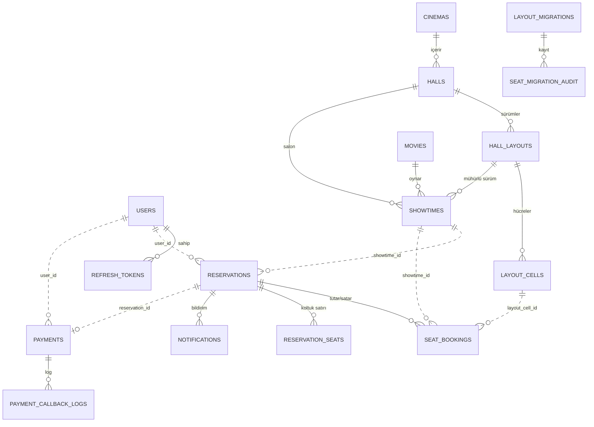

# DB Planlaması – Sinema Koltuk Seçimi & Rezervasyon Sistemi

> Durum: ONAYLANDI (K43, 2026-10-29). Kod yok. Dayanak: [planlama.md](planlama.md) §2 (domain), §3 (servis sınırları), §4 (concurrency), §5 (auth), §7 (API), K9, K13, K17, K29, K30, K35, K36, K40.
> Bu dosya §2.2'deki varlık listesini **tablo/kolon/indeks** düzeyine indirir. Çıkan farklar §8'de listelenir.

## 1. Genel Yapı

| Servis | Veri deposu | Şema / kullanıcı | Amaç (tek cümle) |
|---|---|---|---|
| api-gateway | Redis (yalnızca sayaç) | — | Rate limit sayaçları; **iş verisi yok** |
| auth-service | MySQL | `auth_db` / `auth_user` | Kimlik: kullanıcı, rol, refresh token |
| catalog-service | MySQL | `catalog_db` / `catalog_user` | "Ne, nerede, ne zaman": şube, salon, düzen, film, seans |
| booking-service | MySQL | `booking_db` / `booking_user` | Koltuk durumu, rezervasyon, bilet, bildirim, düzen göçü kaydı (**K9'un garantörü**) |
| payment-service | MySQL | `payment_db` / `payment_user` | Ödeme kaydı ve sağlayıcı (iyzico) denetim logu |

Kurallar (rules §5.5, K31):
- Tek MySQL instance, **4 şema**; her kullanıcı yalnızca kendi şemasında yetkili. Başka şemaya SQL ile erişim, JOIN veya FK **yoktur**.
- Şema yönetimi **Flyway** (`src/main/resources/db/migration`, servis başına). `ddl-auto=validate`.
- Tüm zamanlar `DATETIME(3)` **UTC**; para `DECIMAL(10,2)` (TRY); enum'lar `VARCHAR` + `@Enumerated(STRING)`; PK'ler `BIGINT AUTO_INCREMENT`.
- Audit alanları (`created_at`, `updated_at`) `@EntityListeners(AuditingEntityListener.class)` ile.
- Servisler arası referanslar yalnızca **sayısal id** (FK değil, "yumuşak referans"); bütünlük §5'te.

## 2. Genel ER Şeması (özet)

Kesikli çizgi (`..`) = **servisler arası yumuşak referans**; DB'de FK yoktur.

## 3. Servis Bazında Tablolar

### 3.1 `auth_db` (auth-service)

| Tablo | Amaç |
|---|---|
| `users` | Kimlik. Misafir hesap değildir (K3). |
| `refresh_tokens` | Rotasyonlu refresh token ailesi (K36). Yalnızca **hash** saklanır. |

**`users`**
| Kolon | Tip | Not |
|---|---|---|
| id | BIGINT PK | JWT `sub` değeri; diğer servislerin `user_id`'sinin kaynağı |
| email | VARCHAR(255) | **UNIQUE**, küçük harfe normalize |
| password_hash | VARCHAR(100) | BCrypt (maliyet 12) |
| role | VARCHAR(20) | `USER` \| `ADMIN` |
| failed_login_count | INT | hesap kilidi (5 hata → 5 dk, K36) |
| locked_until | DATETIME(3) NULL | |
| created_at, updated_at | DATETIME(3) | |

**`refresh_tokens`**
| Kolon | Tip | Not |
|---|---|---|
| id | BIGINT PK | |
| user_id | BIGINT FK → users.id | INDEX |
| token_hash | CHAR(64) | **UNIQUE** (SHA-256) |
| family_id | CHAR(36) | INDEX; yeniden kullanım tespitinde aile toplu iptal |
| expires_at | DATETIME(3) | INDEX (temizlik job'ı) |
| revoked_at | DATETIME(3) NULL | |
| replaced_by_id | BIGINT NULL | rotasyon zinciri |
| created_at | DATETIME(3) | |

> Servis kimlik bilgileri (`clientId`/`clientSecret`, §5.5) **tablo değil, env/secret**'tır; ilk ADMIN `.env`'den açılışta oluşturulur.

### 3.2 `catalog_db` (catalog-service)

| Tablo | Amaç |
|---|---|
| `cinemas` | Şube (3 adet, K27) |
| `halls` | Salon (10 adet); aktif düzen sürümüne işaret eder; varsayılan fiyat (K23) |
| `hall_layouts` | **Sürümlü** salon düzeni; yayımlanınca değişmez (K17) |
| `layout_cells` | Düzenin hücreleri; **koltuk kimliği = `layout_cells.id`** |
| `movies` | TMDB'den kopyalanan veya elle girilen film (K16, K18–K22) |
| `movie_genres`, `movie_cast_members`, `movie_content_descriptors` | Film listeleri (düz metin / enum) |
| `showtimes` | Seans: film + salon + mühürlü düzen sürümü + fiyat |

**`cinemas`**: id PK, name, city, address, created_at, updated_at.

**`halls`**
| Kolon | Tip | Not |
|---|---|---|
| id | BIGINT PK | |
| cinema_id | BIGINT FK → cinemas.id | INDEX |
| name | VARCHAR(100) | UNIQUE(cinema_id, name) |
| active_layout_id | BIGINT NULL FK → hall_layouts.id | yalnızca `PUBLISHED` sürüme işaret eder |
| default_ticket_price | DECIMAL(10,2) | seans fiyatının kopyalandığı değer (K23) |
| created_at, updated_at | DATETIME(3) | |

**`hall_layouts`**
| Kolon | Tip | Not |
|---|---|---|
| id | BIGINT PK | |
| hall_id | BIGINT FK → halls.id | |
| version | INT | **UNIQUE(hall_id, version)** |
| status | VARCHAR(20) | `DRAFT` (düzenlenebilir) \| `PUBLISHED` (değişmez) |
| grid_rows, grid_cols | INT | |
| created_at, published_at | DATETIME(3) | |

**`layout_cells`**: yalnızca **boş olmayan** hücreler saklanır.
| Kolon | Tip | Not |
|---|---|---|
| id | BIGINT PK | **booking tarafından `layout_cell_id` olarak kullanılır** |
| layout_id | BIGINT FK → hall_layouts.id | |
| row_index, col_index | INT | **UNIQUE(layout_id, row_index, col_index)**; göçte "aynı yer" eşleşmesi (K35) |
| cell_type | VARCHAR(20) | `SEAT` \| `EMPTY` \| `ENTRANCE` \| `EXIT` \| `SCREEN` \| `WALL` |
| seat_row_label | VARCHAR(5) NULL | yalnızca `SEAT` |
| seat_number | INT NULL | yalnızca `SEAT` |
| seat_type | VARCHAR(20) NULL | `STANDARD` \| `ACCESSIBLE` (K28) |

**`movies`**
| Kolon | Tip | Not |
|---|---|---|
| id | BIGINT PK | |
| tmdb_id | BIGINT NULL | **UNIQUE** (NULL = elle girilmiş) |
| title | VARCHAR(255) | |
| overview | TEXT | düz metin |
| poster_path | VARCHAR(255) NULL | TMDB hotlink için yol (K41) |
| runtime_minutes | INT | seans `ends_at` hesabı |
| release_date | DATE NULL | |
| certification | VARCHAR(10) NULL | TR yaş sınırı (K20) |
| vote_average | DECIMAL(3,1) NULL | TMDB puanı (K19) |
| director | VARCHAR(255) NULL | |
| visible | BOOLEAN | **gizleme, silme yok** (K40) |
| created_at, updated_at | DATETIME(3) | |

**Alt tablolar:** `movie_genres(movie_id FK, genre)`, `movie_cast_members(movie_id FK, position, name)`, `movie_content_descriptors(movie_id FK, descriptor)` — hepsi `PK(movie_id, …)`.

**`showtimes`**
| Kolon | Tip | Not |
|---|---|---|
| id | BIGINT PK | booking'in `showtime_id` kaynağı |
| movie_id | BIGINT FK → movies.id | |
| hall_id | BIGINT FK → halls.id | INDEX(hall_id, starts_at) — çakışma sorgusu |
| layout_id | BIGINT FK → hall_layouts.id | **mühürlü sürüm**; yalnızca K35 `activate` ile güncellenir |
| starts_at, ends_at | DATETIME(3) | `ends_at = starts_at + süre + ara payı` (K26) |
| ticket_price | DECIMAL(10,2) | |
| sales_close_offset_minutes | INT | varsayılan +10 (K10) |
| status | VARCHAR(20) | `SCHEDULED` (iptal kapsam dışı, K34) |
| created_at, updated_at | DATETIME(3) | |

> **Seans çakışması** (§2.4-8) tek UNIQUE ile ifade edilemez: seans oluştururken `halls` satırı `SELECT … FOR UPDATE` ile kilitlenir, çakışma sorgusu aynı transaction'da çalışır.

### 3.3 `booking_db` (booking-service)

| Tablo | Amaç |
|---|---|
| `seat_bookings` | **Koltuk durumunun tek doğruluk kaynağı** (HELD/SOLD); K9 burada |
| `reservations` | İşlem: kullanıcı + seans + durum + bilet kodu + **snapshot** |
| `reservation_seats` | Rezervasyondaki koltuk satırları (etiket + anlık fiyat) |
| `notifications` | Uygulama içi bildirim (K35) |
| `layout_migrations` | Düzen göçü işi (önizleme/uygulama durumu) |
| `seat_migration_audit` | Göçte değişen her biletin denetim kaydı (SOLD istisnası) |
| `hall_maintenance_locks` | Göç sırasında salona ait seanslarda yeni hold'u durdurur |

**`seat_bookings`** — satır yoksa koltuk boştur.
| Kolon | Tip | Not |
|---|---|---|
| id | BIGINT PK | |
| showtime_id | BIGINT | ➜ `catalog.showtimes.id` (yumuşak) |
| layout_cell_id | BIGINT | ➜ `catalog.layout_cells.id` (yumuşak) |
| status | VARCHAR(10) | `HELD` \| `SOLD` |
| hold_expires_at | DATETIME(3) | `min(şimdi+3 dk, satış kapanışı)` (§2.4-2); SOLD'da NULL |
| user_id | BIGINT | ➜ `auth.users.id` |
| reservation_id | BIGINT FK → reservations.id | INDEX |
| version | BIGINT | optimistic locking |
| created_at, updated_at | DATETIME(3) | |

İndeksler: **`UNIQUE(showtime_id, layout_cell_id)` (K9)**, INDEX(showtime_id, status, hold_expires_at) — seat-status sorgusu.

**`reservations`**
| Kolon | Tip | Not |
|---|---|---|
| id | BIGINT PK | |
| user_id | BIGINT | ➜ `auth.users.id` |
| showtime_id | BIGINT | ➜ `catalog.showtimes.id` |
| hall_id | BIGINT | ➜ `catalog.halls.id` (bakım kilidi kontrolü için, hold anında alınır) |
| status | VARCHAR(20) | `PENDING_PAYMENT` \| `CONFIRMED` \| `EXPIRED` \| `FAILED` \| `RELEASED` |
| total_amount | DECIMAL(10,2) | |
| expires_at | DATETIME(3) | hold bitişi; ödeme penceresiyle bir kez uzar (K32) |
| payment_window_extended | BOOLEAN | uzatma tek sefer |
| released_at | DATETIME(3) NULL | kullanıcı bırakması (K40) |
| ticket_code | VARCHAR(32) NULL | **UNIQUE**, rastgele/tahmin edilemez (K30); yalnızca `CONFIRMED` |
| movie_title, cinema_name, hall_name | VARCHAR | **snapshot** (§3.4-1) |
| starts_at | DATETIME(3) | snapshot |
| active_pending_key | VARCHAR(80) NULL | **üretilmiş kolon**: `status='PENDING_PAYMENT'` ise `user_id-showtime_id`, değilse NULL → **UNIQUE** (kullanıcı başına seansta tek aktif rezervasyon, K24) |
| created_at, confirmed_at, updated_at | DATETIME(3) | |

İndeksler: INDEX(user_id, created_at) — "rezervasyonlarım"; INDEX(user_id, status, expires_at) — K29 terk sayacı (`EXPIRED`/`RELEASED`'ın bitiş zamanı: `expires_at` / `released_at`); INDEX(status, expires_at) — süre dolumu job'ı.

**`reservation_seats`** (PK `(reservation_id, layout_cell_id)`)
| Kolon | Tip | Not |
|---|---|---|
| reservation_id | BIGINT FK → reservations.id | |
| layout_cell_id | BIGINT | ➜ `catalog.layout_cells.id` |
| seat_label | VARCHAR(10) | snapshot, örn. `F-7` |
| unit_price | DECIMAL(10,2) | anlık fiyat kopyası |

**`notifications`**: id PK, user_id, type (`SEAT_CHANGED`), reservation_id FK, message, read_at NULL, created_at; INDEX(user_id, read_at).

**`layout_migrations`**: id PK, hall_id ➜ catalog, from_layout_id ➜ catalog, to_layout_id ➜ catalog, status (`PREVIEWED` \| `RUNNING` \| `COMPLETED` \| `ROLLED_BACK` \| `FAILED`), created_by (admin `user_id`), created_at, completed_at.

**`seat_migration_audit`**: id PK, migration_id FK, reservation_id FK, showtime_id, old_layout_cell_id, new_layout_cell_id, old_seat_label, new_seat_label, reason (`SAME_POSITION` \| `REPLACEMENT`), created_at.

**`hall_maintenance_locks`**: hall_id PK (➜ catalog), migration_id FK, locked_at. Satır varsa o salonun seanslarında yeni hold reddedilir.

### 3.4 `payment_db` (payment-service)

| Tablo | Amaç |
|---|---|
| `payments` | Ödeme kaydı (rezervasyon başına tek) |
| `payment_callback_logs` | iyzico callback/retrieve ham kaydı (denetim) |

**`payments`**
| Kolon | Tip | Not |
|---|---|---|
| id | BIGINT PK | |
| reservation_id | BIGINT | ➜ `booking.reservations.id`; **UNIQUE** (rezervasyon başına tek ödeme, §7.2) |
| user_id | BIGINT | ➜ `auth.users.id` (sahiplik kontrolü) |
| provider | VARCHAR(20) | `IYZICO` \| `MOCK` |
| status | VARCHAR(20) | `INITIATED` \| `PENDING` \| `SUCCEEDED` \| `FAILED` \| `REFUND_REQUIRED` |
| amount | DECIMAL(10,2) | **booking'den alınır**, istemci göndermez |
| currency | CHAR(3) | `TRY` |
| conversation_id | VARCHAR(64) | **UNIQUE**; `retrieve` sonucunu eşlemek için |
| provider_token | VARCHAR(255) NULL | **UNIQUE**; callback'te kullanıcıyı bulur |
| provider_payment_id | VARCHAR(64) NULL | **UNIQUE**; idempotency (§4.8) |
| booking_sync_status | VARCHAR(20) | `NOT_NEEDED` \| `PENDING` \| `DONE` \| `FAILED` — booking `confirm/fail` çağrısı (mutabakat job'ı) |
| booking_sync_attempts, next_retry_at | INT, DATETIME(3) NULL | yeniden deneme |
| failure_code | VARCHAR(50) NULL | |
| created_at, updated_at | DATETIME(3) | |

**`payment_callback_logs`**: id PK, payment_id FK NULL, provider_token, event_source (`CALLBACK` \| `RETRIEVE`), retrieve_status, raw_payload (JSON, **kart verisi içermez**, hassas alan maskeli), received_at; INDEX(payment_id), INDEX(received_at) (90 günlük temizlik job'ı için, K43).

## 4. Servisler Arası Kolon Bağımlılıkları (yumuşak referanslar)

DB düzeyinde **FK yoktur**; sütun, başka servisin id'sini taşır. Okuma gerektiğinde **API** (Feign) kullanılır.

| Taşıyan kolon (servis.tablo.kolon) | Gösterdiği (servis.tablo.kolon) | Neden |
|---|---|---|
| booking.seat_bookings.showtime_id | catalog.showtimes.id | Koltuk hangi seansa ait; K9 kısıtının yarısı |
| booking.seat_bookings.layout_cell_id | catalog.layout_cells.id | Koltuk kimliği; K9 kısıtının diğer yarısı |
| booking.seat_bookings.user_id | auth.users.id | Kim tutuyor (K29, sahiplik) |
| booking.reservations.user_id | auth.users.id | Rezervasyon sahibi |
| booking.reservations.showtime_id | catalog.showtimes.id | Hangi seans |
| booking.reservations.hall_id | catalog.halls.id | Bakım kilidi (K35) |
| booking.reservation_seats.layout_cell_id | catalog.layout_cells.id | Bilet koltuğu |
| booking.notifications.user_id | auth.users.id | Bildirim sahibi |
| booking.layout_migrations.hall_id / from_layout_id / to_layout_id | catalog.halls.id / catalog.hall_layouts.id | Göç işi (K35) |
| booking.layout_migrations.created_by | auth.users.id | Hangi admin |
| payment.payments.reservation_id | booking.reservations.id | Ödemenin ait olduğu rezervasyon |
| payment.payments.user_id | auth.users.id | Sahiplik kontrolü |

### 4.1 Çalışma anında başka serviste **okunan** değerler (kolon bağımlılığı, API ile)
| Okuyan | Kaynak | Okunan alanlar | Ne zaman |
|---|---|---|---|
| booking | catalog (`showtimes`, `halls`, `cinemas`, `movies`, `layout_cells`) | `starts_at`, `sales_close_offset_minutes`, `ticket_price`, `layout_id`, `hall_id`; film/şube/salon **adı**; hücrenin `SEAT` olması ve `seat_row_label`/`seat_number` | Hold anı → **snapshot'a kopyalanır** (`reservations`, `reservation_seats`); sonrası catalog'a ihtiyaç yok |
| payment | booking (`reservations`) | `total_amount`, `status`, `user_id` | Ödeme başlatırken (tutar sunucudan) |
| payment | booking | `confirm` / `fail` / `extend-payment-window` (yazma) | Ödeme sonucu |
| booking | catalog | iki düzen sürümünün `layout_cells` verisi, etkilenen seanslar | Yalnızca K35 göç önizleme/uygulama |
| booking | catalog (`activate`, yazma) | `halls.active_layout_id`, `showtimes.layout_id` | Göçün son adımı (§7.8) |

## 5. Bütünlük ve Silme Kuralları (FK olmadan)
1. **Sarkan referans oluşmaz:** `users`, `showtimes`, `halls`, `hall_layouts`, `layout_cells` **silinmez** (kullanıcı silme yok, seans silme/iptal yok K34, yayımlanmış düzen değişmez, film gizlenir K40). Referans veren servisler bu yüzden id'ye güvenebilir.
2. **Oluşturma anında doğrulama:** booking, hücrenin gerçekten `SEAT` ve seansın düzenine ait olduğunu catalog'dan sorar (fail fast, §4.3). payment, rezervasyonun sahibini booking'den doğrular.
3. **Tek yönlü bağımlılık** korunur: payment → booking → catalog (+ K35 için booking → catalog yazma `activate`); catalog hiçbir servisi çağırmaz.
4. **Tutarlılık:** servisler arası işlemler Saga/eventual consistency (ödeme `SUCCEEDED` ama `confirm` bekliyor → `booking_sync_status` + mutabakat job'ı).
5. **K35 göçü** SOLD satırın `layout_cell_id`'sini (ve `reservation_seats.layout_cell_id`, `seat_label`) yalnızca göç işlemiyle ve `seat_migration_audit` kaydıyla değiştirir.

## 6. Önemli İndeks ve Kısıt Özeti
| Kısıt | Amaç |
|---|---|
| `seat_bookings UNIQUE(showtime_id, layout_cell_id)` | **K9: aynı koltuk iki kişiye satılamaz** |
| `reservations UNIQUE(active_pending_key)` (üretilmiş kolon) | Kullanıcı başına seansta tek aktif işlem (K24) |
| `reservations UNIQUE(ticket_code)` | Bilet doğrulama (K30) |
| `payments UNIQUE(reservation_id)`, `UNIQUE(provider_token)`, `UNIQUE(conversation_id)` | Ödeme idempotency, callback eşleme |
| `users UNIQUE(email)`, `refresh_tokens UNIQUE(token_hash)` | Kimlik |
| `hall_layouts UNIQUE(hall_id, version)`, `layout_cells UNIQUE(layout_id, row_index, col_index)` | Düzen bütünlüğü |
| `movies UNIQUE(tmdb_id)` | Aynı film iki kez eklenmez |

## 7. Redis (iş verisi değil)
| Kullanan | İçerik | Ömür |
|---|---|---|
| api-gateway | Rate limit sayaçları (IP / rota başına) | Pencere süresi kadar (TTL) |

Hold kilidi, koltuk durumu veya oturum için **kullanılmaz** (gerçek kaynak MySQL, §4.2-C reddedildi).

## 8. planlama.md §2.2 ile Farklar (onay gerekir)
1. **`ReservationSeat`:** §2.2'de `seatBookingId` tutuyordu. Süresi dolan `HELD` satırlar temizlik job'ıyla silindiği için bu FK sarkardı; bunun yerine `layout_cell_id` + `seat_label` kullanılır. `seat_bookings.reservation_id` ters yönü taşır.
2. **Yeni tablolar:** `notifications`, `layout_migrations`, `seat_migration_audit`, `hall_maintenance_locks` (K35); `payment_callback_logs` (§2.2'de "ayrı tutulur" denmişti); `movie_genres/cast/descriptors` (liste alanları).
3. **Yeni kolonlar:** `reservations` snapshot alanları, `hall_id`, `released_at`, `payment_window_extended`, `ticket_code`, `active_pending_key`; `payments.booking_sync_*`; `movies.visible`; `hall_layouts.status`.
4. **`Showtime.status`** yalnızca `SCHEDULED` (iptal kapsam dışı, K34).

## 9. Cevaplar (2026-10-29) → K43
1 → film listeleri (tür/oyuncu/işaret) **ayrı tablolarda** (`movie_genres`, `movie_cast_members`, `movie_content_descriptors`); 2 → `active_pending_key` **üretilmiş kolon + UNIQUE** (DB garantisi); 3 → süresi dolan `HELD` satırlar temizlik job'ıyla **silinir**, `SOLD` satırlar kalır (değişmez 5, K6); 4 → ham callback logu (`raw_payload`) **90 gün** tutulur, sonra temizlik job'ı siler (süre konfigürasyondan).

DB planlaması tamam. Durum: ONAYLANDI.

Eski sorular (referans):
1. **Film listeleri** (tür/oyuncu/işaret) ayrı tablolar mı (öneri, sorgulanabilir), yoksa `movies` içinde JSON kolonları mı?
2. **`active_pending_key` üretilmiş kolon** (MySQL'de kısmi unique index yok) uygun mu, yoksa bu kuralı yalnızca servis kodu + seans bazlı kilitle mi sağlayalım? (Öneri: üretilmiş kolon, DB garantisi.)
3. **`seat_bookings` temizliği:** süresi dolan `HELD` satırlar silinir, `SOLD` satırlar kalır (ödenmiş geçmiş `reservations`/`reservation_seats`'te de durur). Uygun mu?
4. **Ham callback logu** (`raw_payload`) ne kadar süre tutulsun (öneri: 90 gün, sonra temizlik job'ı)?
